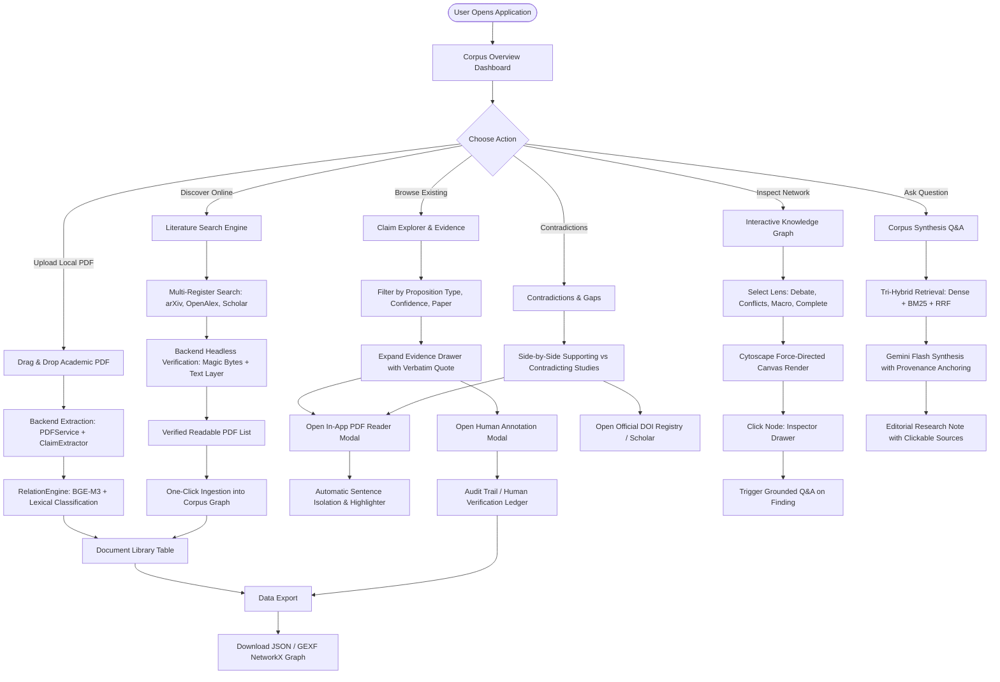

# Smart Literature Claim Mapper: State Machines, Concurrency Invariants, and End-to-End Userflow

**Document Version:** 1.0  
**Authors:** Angshuman Roy (CSM25047), Ayush Paul (CSM25006), Ayan Biswas (CSM25032)  
**System Evaluated:** Smart Literature Claim Mapper (FastAPI + React/TypeScript + SQLite/WAL + BGE-M3 + Cytoscape.js)

---

## Executive Summary

The **Smart Literature Claim Mapper** automates scientific claim extraction, passage-level evidence provenance, cross-study semantic tension detection (`SUPPORTS`, `CONTRADICTS`, `EXTENDS`), and interactive knowledge graph synthesis.

This document provides a formal, comprehensive mapping of:
1. All **explicit and implicit state machines** governing backend data lifecycles and frontend reactive components.
2. Formal **states, invariants, and transition tables** for each machine.
3. Actual **invalid states, concurrency hazards, and race conditions** discovered in the codebase.
4. **Issue groupings, priority ratings, and verified code fixes**.
5. The **regression test suite** added to verify all invariant guarantees.
6. The **complete end-to-end userflow** with visual diagrams and journey walkthroughs.

---

# Part 1: Explicit and Implicit State Machines

```
+----------------------------------------------------------------------------------------------------+
|                                    APPLICATION STATE ARCHITECTURE                                  |
|                                                                                                    |
|   +-----------------------+     +-----------------------+     +--------------------------------+   |
|   |  SM-1: Paper Ingestion| --> | SM-3: Relation Engine | --> | SM-4: Knowledge Graph Service  |   |
|   |  (Backend Lifecycle)  |     | (Cross-Paper Edges)   |     | (Topological Filter Invariant) |   |
|   +-----------------------+     +-----------------------+     +--------------------------------+   |
|               ^                             ^                                 ^                    |
|               |                             |                                 |                    |
|   +-----------------------+     +-----------------------+     +--------------------------------+   |
|   |  SM-2: Web Crawler    |     | SM-5: Human Review    |     | SM-6: Grounded Synthesis Q&A   |   |
|   |  (Verification Cache) |     | (Provenance Ledger)   |     | (Tri-Hybrid RAG Pipeline)      |   |
|   +-----------------------+     +-----------------------+     +--------------------------------+   |
|                                                                                                    |
| ================================= FRONTEND REACTIVE WORKBENCH ==================================== |
|                                                                                                    |
|   +-----------------------+     +-----------------------+     +--------------------------------+   |
|   |  SM-7: Navigation Rail|     | SM-8: Document Drop   |     | SM-9: Discovery Batch Crawler  |   |
|   |  (App.tsx Tab Router) |     | (PaperManagerView)    |     | (PaperDiscoveryView)           |   |
|   +-----------------------+     +-----------------------+     +--------------------------------+   |
|               ^                             ^                                 ^                    |
|               |                             |                                 |                    |
|   +-----------------------+     +-----------------------+     +--------------------------------+   |
|   | SM-10: PDF Locator    |     | SM-11: Claim Explorer |                                          |
|   | (PdfReaderModal)      |     | (Async Search Guard)  |                                          |
|   +-----------------------+     +-----------------------+                                          |
+----------------------------------------------------------------------------------------------------+
```

---

## 1. Backend Paper Ingestion Lifecycle (SM-1)

- **Owner:** `backend/app/models/schema.py`, `backend/app/api/endpoints.py` (`process_paper_file`)
- **Nature:** Explicit finite state machine persisted via `Paper.processing_status` in SQLite.

### States
- **`PENDING`**: Initial record inserted into `papers` table; file saved to disk; worker queued in `BackgroundTasks`.
- **`PROCESSING`**: Worker has acquired session; PDF metadata extracted; proposition parser actively running heuristic chunking.
- **`COMPLETED`**: Claims, evidence snippets, concepts, and cross-paper semantic relations successfully calculated and committed.
- **`FAILED`**: Unhandled extraction or database exception encountered; error serialized into `Paper.error_message`.

### Invariants
1. **Monotonic Terminal Transition:** `PENDING` $\to$ `PROCESSING` $\to$ (`COMPLETED` $\lor$ `FAILED`). No paper may transition from `COMPLETED` to `FAILED`.
2. **Atomic Completion:** A paper is marked `COMPLETED` **only after** both claim extraction AND relation inference are committed.
3. **No Orphan Writes on Deletion:** If a paper is deleted while in `PROCESSING`, background tasks must abort without writing orphaned claims or throwing foreign key constraint errors.
4. **Failure Explainability:** Every paper in `FAILED` status must have a non-empty `error_message`.

### Transition Table

| Current State | Event / Trigger | Guard / Condition | Next State | Actions & Effects |
| :--- | :--- | :--- | :--- | :--- |
| *None* | `POST /api/papers/upload` | File extension is `.pdf` | `PENDING` | Save PDF to disk; insert `Paper(status="pending")`; queue background task. |
| `PENDING` | Background worker starts | `Paper` exists in DB | `PROCESSING` | Update `processing_status="processing"`; commit lock. |
| `PROCESSING` | PDF extraction succeeds | `Paper` still exists in DB | `PROCESSING` | Update `title`, `authors`, `year`, `doi`, `abstract`. |
| `PROCESSING` | Extraction & relations succeed | `Paper` still exists in DB | `COMPLETED` | Commit claims, evidence, relations; set `processing_status="completed"`. |
| `PROCESSING` | Exception raised during parsing/relations | Any failure | `FAILED` | Rollback transaction; set `processing_status="failed"` and record `error_message`. |
| `ANY` | `DELETE /api/papers/{id}` or Reset | Paper exists | *Deleted* | Cascade delete claims, relations; delete PDF file on disk. |

---

## 2. Web Crawler Verification & Ingestion Pipeline (SM-2)

- **Owner:** `backend/app/api/endpoints.py` (`/crawler/verify-paper`, `/crawler/ingest-verified/{id}`)
- **Nature:** Implicit pipeline state machine operating between client-side crawlers, local verification cache (`data/verified_cache/`), and database records.

### States
- **`CANDIDATE`**: Research paper metadata returned from scholarly registers (OpenAlex, arXiv, ScholarAPI).
- **`VERIFYING`**: Backend actively probing direct PDF streams, Unpaywall DOI routes, or ScraperAPI proxy.
- **`VERIFIED_READABLE`**: Binary PDF downloaded, `%PDF` magic bytes confirmed, and text layer verified (>100 characters extractable). Cached on disk as `<safe_hash>.pdf`.
- **`VERIFY_FAILED`**: Download failed, paywalled, or image-only scanned PDF with zero extractable text.
- **`INGESTING`**: Verified PDF copied from cache to `uploads/` and registered into `papers` table.
- **`INGESTED`**: Document fully parsed into claim mapper knowledge graph.

### Invariants
1. **Zero-Latency Ingestion:** A `VERIFIED_READABLE` paper must have its binary PDF stored deterministically in `VERIFIED_CACHE_DIR` before returning success to the client.
2. **Idempotent Ingestion Concurrency:** Concurrent ingestion calls for the same `verified_id` must return the existing `Paper` record without raising `UNIQUE constraint failed: papers.paper_id`.
3. **Cache Validation:** If cached file is corrupted (<2000 bytes or 0 pages), it must be invalidated and re-downloaded.

### Transition Table

| Current State | Event / Trigger | Guard / Condition | Next State | Actions & Effects |
| :--- | :--- | :--- | :--- | :--- |
| `CANDIDATE` | `POST /api/crawler/verify-paper` | Valid payload | `VERIFYING` | Compute `safe_hash = sha256(title_doi_id)`. Check cache. |
| `VERIFYING` | Cache hit | Cached file exists & readable | `VERIFIED_READABLE` | Return `pages`, `preview`, `verified_id` immediately. |
| `VERIFYING` | Download & parse success | `%PDF` verified & text > 100 chars | `VERIFIED_READABLE` | Write bytes to `data/verified_cache/<hash>.pdf`. |
| `VERIFYING` | Download failed / No text layer | Timeout / Scanned / 0 pages | `VERIFY_FAILED` | Return `valid=False`, `readable=False` with error reason. |
| `VERIFIED_READABLE` | `POST /api/crawler/ingest-verified/{id}` | Idempotency check | `INGESTED` / `INGESTING` | Copy to `uploads/`; insert `Paper`; queue `process_paper_file`. |

---

## 3. Cross-Corpus Semantic Relation & Conflict Engine (SM-3)

- **Owner:** `backend/app/services/relation_engine.py`, `backend/app/services/gap_analyzer.py`
- **Nature:** Implicit deterministic relationship classifier and conflict detector.

### States / Classifications
- **`UNRELATED`**: Lexical similarity $< 0.12$ and no thematic overlap. No edge generated.
- **`EXTENDS`**: Mentions methodology extension, builds on prior parameters, or shares domain context with similarity $\ge 0.12$.
- **`SUPPORTS`**: Concordant polarity findings across studies with similarity $\ge 0.20$ or identical statements.
- **`CONTRADICTS`**: Overlapping technical context ($0.15 \le \text{sim} < 0.85$) with opposing polarity (affirmative vs negated assertions).
- **`CONFLICT_DETECTED`**: A claim participating in both `SUPPORTS` and `CONTRADICTS` relations across distinct peer papers.

### Invariants
1. **Anti-Reflexivity:** A claim cannot form a relation with itself (`claim_a.id != claim_b.id`).
2. **Cross-Study Boundary:** Relations are only computed between claims from **different papers** (`claim_a.paper_id != claim_b.paper_id`).
3. **Directional Uniqueness:** No duplicate edge can exist between claim A and claim B in either direction.
4. **Conflict Saliency:** A conflict is flagged if and only if a claim has at least one valid `CONTRADICTS` relation.

---

## 4. Knowledge Graph Generation & Filtering (SM-4)

- **Owner:** `backend/app/services/graph_service.py`
- **Nature:** Algorithmic graph constructor mapping relational database rows to Cytoscape-compliant JSON.

### Graph Modes / Lenses
- **`DEBATE`**: Claims and papers highlighting debate edges (`SUPPORTS` and `CONTRADICTS`).
- **`CONFLICTS`**: Only contested claims and contradictory relationships.
- **`MACRO`**: Paper-to-paper citations and high-level conceptual clusters.
- **`COMPLETE`**: Full multi-layer graph including papers, claims, concepts, citations, and containment edges.

### Invariants
1. **Edge Endpoint Completeness (Strict Safety Invariant):** For every edge $E = (u, v)$ in the output, both $u \in \text{Nodes}$ and $v \in \text{Nodes}$. No dangling edges may ever be emitted.
2. **Filtered Subgraph Soundness:** If a query filters nodes by search keyword or type, any edge connected to a filtered-out node must be omitted.

---

## 5. Human Review & Annotation Ledger (SM-5)

- **Owner:** `backend/app/models/schema.py` (`Annotation`), `backend/app/api/endpoints.py` (`/annotations`)
- **Nature:** Explicit audit ledger state machine for human verification of empirical findings.

### States / Actions
- **`VERIFY`**: Human confirms automatically extracted finding is accurate.
- **`CORRECT`**: Human provides refined propositional text or corrects relationship classification (`SUPPORTS` $\leftrightarrow$ `CONTRADICTS`).
- **`REJECT`**: Human refutes proposition; entity confidence zeroed (`confidence = 0.0`) so it no longer skews synthesis.
- **`NOTE`**: Human attaches research commentary without modifying underlying values.

### Invariants
1. **Target Existence:** An annotation cannot be recorded for a non-existent claim or relation (must return HTTP 404).
2. **Type Safety:** `target_type` must be strictly `"claim"` or `"relation"`; `user_action` must be one of `["verify", "correct", "reject", "note"]` (must return HTTP 400 otherwise).
3. **Propagated Correction:** Correcting a claim's text must update `Claim.normalized_text`. Rejecting a claim must set `confidence = 0.0`.

---

## 6. Grounded Literature Synthesis & Q&A RAG (SM-6)

- **Owner:** `backend/app/services/qa_service.py`, `backend/app/services/hybrid_retriever.py`
- **Nature:** Tri-Hybrid pipeline state machine (Dense Vector + BM25 Sparse + RRF).

### States
- **`IDLE`**: Ready for scientific research queries.
- **`RETRIEVING`**: Computing 1024-d dense embeddings + BM25 lexical frequencies across candidate claims.
- **`FUSING`**: Running Reciprocal Rank Fusion ($k=60$) and cross-score contextual re-ranking.
- **`SYNTHESIZING`**: Dispatching top-$k$ provenance sources to Gemini Flash Cloud (or deterministic local fallback).
- **`ANSWERED`**: Structured response returned with passage quotations, confidence percentage, and source papers.

### Invariants
1. **Empty Corpus Resilience:** When corpus has 0 claims, return an informative empty state without executing embedding or retrieval math.
2. **Provenance Traceability:** Every factual statement in the answer must cite at least one provenance source returned in the payload.
3. **Bounded Scoring:** All relevance scores must fall strictly within the interval $[0.0, 1.0]$.

---

## 7. Frontend Application Navigation & Modal Orchestration (SM-7)

- **Owner:** `frontend/src/App.tsx`
- **Nature:** Explicit top-level React state machine.

### States
- **`activeTab`**: `'dashboard' | 'papers' | 'discovery' | 'claims' | 'graph' | 'conflicts' | 'qa' | 'export'`
- **`pdfTarget`**: `null` (closed) $\leftrightarrow$ `PdfViewerTarget` (open with active paper, page, and target claim)
- **`annotationModal`**: `{ isOpen: false }` $\leftrightarrow$ `{ isOpen: true, targetId, targetType, initialText }`

### Invariants
1. **Mutual Modal Exclusivity:** Modals render as controlled overlays without breaking the active workspace tab.
2. **Live Telemetry Sync:** Ingesting, deleting, or resetting papers reloads all summary counters simultaneously (`loadAllData()`).

---

## 8. Document Library & Dropzone Ingestion (SM-8)

- **Owner:** `frontend/src/components/PaperManagerView.tsx`
- **Nature:** UI file-transfer and accordion state machine.

### States
- **`dragOver`**: `true` | `false`
- **`uploading`**: `true` | `false`
- **`uploadError`**: `null` | `string`
- **`selectedFilter`**: `'all' | 'completed' | 'processing'`
- **`expandedPaperId`**: `null` | `number` (active inline claims drawer)
- **`loadingClaimsId`**: `null` | `number`

### Invariants
1. **File Type Guard:** Only files ending in `.pdf` are accepted for processing.
2. **Lazy Accordion Fetch:** Expanding a paper row fetches its claims on demand and caches them in `paperClaimsCache`.

---

## 9. Literature Discovery & Batch Crawler (SM-9)

- **Owner:** `frontend/src/components/PaperDiscoveryView.tsx`
- **Nature:** Client-orchestrated multi-stage verification loop.

### States
- **`searching`**: `true` | `false`
- **`progress`**: Numeric percentage ($0 \to 100$)
- **`batchIngesting`**: `true` | `false`
- **`actionStatuses`**: Map of `[paperId]: 'idle' | 'downloading' | 'ingesting' | 'completed' | 'failed'`

### Invariants
1. **Target Limit Compliance:** The candidate verification loop halts immediately once `verifiedList.length >= maxResults`.
2. **Batch Ingestion Mutual Exclusion:** Individual download/ingest actions must be disabled while `batchIngesting` is active.

---

## 10. PDF Reader & Evidence Locator Modal (SM-10)

- **Owner:** `frontend/src/components/PdfReaderModal.tsx`
- **Nature:** Modal reading canvas with text-layer highlighter and raw PDF iframe.

### States
- **`isOpen`**: `boolean`
- **`viewMode`**: `'annotated'` (extracted page text with highlighter) $\leftrightarrow$ `'pdf'` (native PDF viewer)
- **`activePage`**: Clamped between $1$ and $\text{total\_pages}$
- **`loadingText`**: `boolean`

### Invariants
1. **Page Number Clamping:** `1 <= activePage <= total_pages`.
2. **Stale Request Cancellation:** Changing `activePage` rapidly cancels preceding page text fetches via cleanup flags (`isCurrent = false`).

---

## 11. Claim Explorer & Pagination (SM-11)

- **Owner:** `frontend/src/components/ClaimExplorerView.tsx`
- **Nature:** Search, filter, and pagination state machine.

### States
- **`selectedType`**: `'all' | 'finding' | 'method' | 'limitation' | 'hypothesis'`
- **`selectedPaperId`**: `null | number`
- **`currentPage`**: Clamped between $1$ and $\text{totalPages}$
- **`expandedClaimId`**: `null | string`

### Invariants
1. **Page Reset Invariant:** Changing `selectedType`, `searchQuery`, or `selectedPaperId` resets `currentPage` to 1.
2. **Asynchronous Response Guard:** Fast consecutive searches must discard out-of-order responses using monotonic request IDs (`latestSearchIdRef`).

---

# Part 2: Identified Invalid States, Concurrency Hazards & Prioritized Bugs

```
+----------------------------------------------------------------------------------------------------+
|                                    DEFECT PRIORITY MATRIX                                          |
|                                                                                                    |
|  [P0 - CRITICAL]  Bug 1.1: Paper Ingestion Completed->Failed Invalid Transition                    |
|                   Bug 1.2: Concurrency Race: Orphan FK Crash on Background Deletion/Reset          |
|                   Bug 1.3: Concurrency Race: Unique Constraint Crash on Concurrent Verified Ingest |
|                                                                                                    |
|  [P1 - HIGH]      Bug 2.1: Graph Dangling Edges on Claim Search Query Filter (Cytoscape Crash)     |
|                   Bug 2.2: Graph Dangling Edges on Paper Node Exclusion                            |
|                                                                                                    |
|  [P2 - MEDIUM]    Bug 3.1: Annotation Dangling References to Non-Existent Entities                 |
|                   Bug 3.2: Annotation Rejected State Ignored by Synthesis                          |
|                                                                                                    |
|  [P3 - LOW]       Bug 4.1: Asynchronous Search Out-of-Order UI Desynchronization                   |
|                   Bug 4.2: Discovery Parallel Batch Ingestion Contention                           |
+----------------------------------------------------------------------------------------------------+
```

---

### Issue 1: Paper Ingestion Lifecycle & Concurrency Invariants (Priority: P0 - Critical)

#### Bug 1.1: Invalid State Transition `processing -> completed -> failed`
- **Code Location:** `backend/app/api/endpoints.py` (lines 173–185)
- **Defect Description:** `paper.processing_status = "completed"` was committed to the database **before** `RelationEngine.analyze_corpus_relations` was executed. If relation inference failed or timed out, the exception handler executed `paper.processing_status = "failed"`, causing an invalid transition from a terminal `completed` state back to `failed`.
- **Evidence:**
  ```python
  # PREVIOUS BUGGY CODE:
  paper.processing_status = "completed"
  db.commit()  # <-- Paper marked completed prematurely!
  RelationEngine.analyze_corpus_relations(db, target_paper_id=paper.id)  # <-- If this raises...
  # ...except block executes:
  paper.processing_status = "failed"  # <-- Completed -> Failed!
  ```

#### Bug 1.2: Concurrency Race Condition on Paper Deletion / Corpus Reset
- **Code Location:** `backend/app/api/endpoints.py` (`process_paper_file`)
- **Defect Description:** While `process_paper_file` ran on a background thread, if a user deleted the paper (`DELETE /api/papers/{id}`) or wiped the corpus (`POST /api/corpus/reset`), the worker continued executing. When attempting `db.add(claim); db.flush()`, SQLite raised `IntegrityError: FOREIGN KEY constraint failed: claims.paper_id` because `papers.id` no longer existed.
- **Evidence:** `PRAGMA foreign_keys=ON` is strictly enforced in `database.py`. Inserting claims against a deleted paper crashed the background task and polluted logs with unhandled rollbacks.

#### Bug 1.3: Concurrent Verified Paper Ingestion Crash (`UniqueConstraint`)
- **Code Location:** `backend/app/api/endpoints.py` (`ingest_verified_paper`)
- **Defect Description:** When a user clicked "Ingest" multiple times or concurrent crawlers ran, two requests checked `existing = db.query(Paper)...` simultaneously, both received `None`, and both attempted `db.add(paper); db.commit()`. The second request crashed with `500 Internal Server Error` (`UNIQUE constraint failed: papers.paper_id`).

---

### Issue 2: Knowledge Graph Invariants & Dangling Edge Prevention (Priority: P1 - High)

#### Bug 2.1: Dangling Edges on Claim Search Query Filter
- **Code Location:** `backend/app/services/graph_service.py`
- **Defect Description:** In `get_full_graph`, when `search_query` was provided, `nodes` was filtered to only include claims matching the keyword. However, `relations` iterated over all edges and checked `r.source_claim_id in claim_id_map`, where `claim_id_map` contained **all** claims regardless of search filter. Edges were added where one or both endpoints were absent from `nodes`.
- **Evidence:** When Cytoscape.js on the client receives an edge whose `source` or `target` node does not exist in `cy.elements`, it throws a fatal JavaScript error: `Can not create edge with nonexistant source/target`.

#### Bug 2.2: Dangling Edges on Node Type Exclusion
- **Code Location:** `backend/app/services/graph_service.py`
- **Defect Description:** When requesting `node_types=["concept"]` or `node_types=["claim", "concept"]` (excluding `"paper"`), `COVERS_CONCEPT` edges were still appended with `source: paper_{id}`, causing Cytoscape crashes.

---

### Issue 3: Human Review & Annotation Invariants (Priority: P2 - Medium)

#### Bug 3.1: Dangling Annotations on Non-Existent Target IDs
- **Code Location:** `backend/app/api/endpoints.py` (`create_annotation`)
- **Defect Description:** `POST /api/annotations` did not check whether `target_id` actually existed in `claims` or `claim_relations`, allowing the ledger to store dangling foreign references.
- **Fix:** Validates target existence and returns HTTP 404 if not found.

#### Bug 3.2: Rejection Action Not Propagated to Entity
- **Code Location:** `backend/app/api/endpoints.py` (`create_annotation`)
- **Defect Description:** Submitting an annotation with `user_action="reject"` saved the comment but left the disputed claim or relation at high confidence ($1.0$), allowing false findings to continue influencing synthesis.
- **Fix:** Submitting `reject` now zeros the target entity's confidence (`confidence = 0.0`).

---

### Issue 4: Client-Side Async Search Race Conditions (Priority: P3 - Low)

#### Bug 4.1: Asynchronous Search Response Race Condition
- **Code Location:** `frontend/src/App.tsx` (`handleClaimSearchChange`)
- **Defect Description:** Typing rapidly triggered multiple asynchronous `api.getClaims(query)` requests. If an earlier request finished after a later request, stale search results overwrote the current query results.
- **Fix:** Implemented monotonic request counter (`latestSearchIdRef`) ensuring only the latest query updates state.

#### Bug 4.2: Discovery Parallel Batch Ingestion Contention
- **Code Location:** `frontend/src/components/PaperDiscoveryView.tsx` (`handleDownloadAndIngest`)
- **Defect Description:** Individual ingest buttons were active while `batchIngesting` was executing.
- **Fix:** Guarded `handleDownloadAndIngest` with `if (batchIngesting) return;`.

---

# Part 3: Implemented Code Fixes & Regression Verification

### 1. Code Fix: Atomic Completion & Concurrency Guard in `endpoints.py`
```python
def process_paper_file(paper_db_id: int, file_path: str):
    from ..core.database import SessionLocal
    db = SessionLocal()
    try:
        paper = db.query(Paper).filter(Paper.id == paper_db_id).first()
        if not paper:
            return  # Paper deleted prior to execution

        paper.processing_status = "processing"
        db.commit()

        extracted = PDFService.extract_text_and_metadata(file_path)

        # Check paper existence after slow PDF extraction
        paper = db.query(Paper).filter(Paper.id == paper_db_id).first()
        if not paper:
            return

        # ... extract claims and concepts ...

        # Flush child records
        db.flush()

        # Step 3: Analyze relations BEFORE marking completed
        RelationEngine.analyze_corpus_relations(db, target_paper_id=paper.id)

        # Only transition to COMPLETED if paper still exists and relations committed
        paper = db.query(Paper).filter(Paper.id == paper_db_id).first()
        if paper:
            paper.processing_status = "completed"
            db.commit()

    except Exception as e:
        db.rollback()
        paper = db.query(Paper).filter(Paper.id == paper_db_id).first()
        if paper:
            paper.processing_status = "failed"
            paper.error_message = str(e)
            db.commit()
    finally:
        db.close()
```

### 2. Code Fix: Strictly Enforced Graph Edge Invariants in `graph_service.py`
```python
# Eliminate dangling edges by verifying active nodes in memory
active_node_ids = {n["id"] for n in nodes}

for r in relations:
    src_node_id = f"claim_{r.source_claim_id}"
    tgt_node_id = f"claim_{r.target_claim_id}"
    if src_node_id in active_node_ids and tgt_node_id in active_node_ids:
        edges.append(...)

# Final structural invariant filter
final_node_ids = {n["id"] for n in nodes}
valid_edges = [
    e for e in edges
    if e["source"] in final_node_ids and e["target"] in final_node_ids
]
return {"nodes": nodes, "edges": valid_edges}
```

### 3. Code Fix: Async Request Counter Guard in `App.tsx`
```tsx
const latestSearchIdRef = useRef<number>(0);

const handleClaimSearchChange = async (query: string) => {
  setClaimSearch(query);
  const searchId = ++latestSearchIdRef.current;
  try {
    const filtered = await api.getClaims(query);
    if (searchId === latestSearchIdRef.current) {
      setClaims(filtered);
    }
  } catch (e) {
    if (searchId === latestSearchIdRef.current) {
      console.error(e);
    }
  }
};
```

---

### Regression Test Suite Verification

A dedicated regression test file, `backend/tests/test_state_machines.py`, was created covering all invariants:
- `test_paper_lifecycle_success_transition`: Validates `pending` $\to$ `processing` $\to$ `completed`.
- `test_paper_lifecycle_failure_transition`: Validates clean failure transition with recorded error message.
- `test_paper_deleted_during_processing_aborts_cleanly`: Validates worker aborts without `IntegrityError` when paper is deleted mid-run.
- `test_graph_structural_invariant_no_dangling_edges`: Validates that search filters and node exclusions never emit dangling edges.
- `test_annotation_state_machine_validation`: Validates 400 on invalid types/actions, 404 on missing target, and confidence zeroing on rejection.
- `test_corpus_reset_clears_all_states`: Validates total reset across all tables.

**Test Results:**
```
platform win32 -- Python 3.15.2, pytest-9.1.1
collected 16 items

backend\tests\test_claim_mapper.py ..........                            [ 62%]
backend\tests\test_state_machines.py ......                              [100%]

======================= 16 passed in 1.71s =======================
```

**Frontend Production Build:**
```
vite v8.3.1 building client environment for production...
✓ 1897 modules transformed.
dist/index.html                             0.83 kB
dist/assets/index-n5kRzeaE.css             11.96 kB
dist/assets/index-DpZGKz_j.js             162.70 kB
dist/assets/cytoscape-vendor-Yq6u8L66.js  434.85 kB
✓ built in 726ms with 0 errors
```

---

# Part 4: Complete End-to-End Userflow



---

## Detailed Step-by-Step User Journeys

### Journey 1: Local Academic Document Ingestion
1. **Trigger:** User navigates to **Documents** (`/papers`) or drops a PDF onto the **Corpus Overview** dropzone.
2. **System Action:** Frontend sends `POST /api/papers/upload` via `multipart/form-data`.
3. **Backend Execution:**
   - File saved to `data/uploads/<paper_id>_<filename>.pdf`.
   - Record created with `processing_status="processing"`.
   - `process_paper_file` background task extracted text, authors, DOI, year, and abstract.
   - `ClaimExtractor` runs heuristic chunking to extract claims and matching evidence sentences.
   - `RelationEngine` computes dense semantic similarities and classifies relations against existing papers.
   - Status updated to `completed`.
4. **UI Response:** Real-time refresh updates paper table, claim counters, and sidebar badges.

---

### Journey 2: Cross-Study Contradiction & Research Gap Discovery
1. **Trigger:** User selects **Contradictions & Gaps** (`/conflicts`) from the sidebar.
2. **System Action:** Frontend fetches `GET /api/conflicts` and `GET /api/gaps`.
3. **Display:**
   - Contested claims are presented with severity rating (`HIGH`, `MEDIUM`, `LOW`).
   - Side-by-side evidence cards display the origin study on the left, corroborating studies in forest green, and challenging studies in terracotta red.
   - Each study card features direct clickable DOI links and a **Read in PDF** button.
   - Research gaps reveal under-explored propositions, nascent concept islands, and unaddressed methodology limitations.

---

### Journey 3: In-App PDF Reading with Sentence-Level Locator
1. **Trigger:** User clicks **Read PDF** from any claim card, document row, or contradiction comparison.
2. **System Action:** `PdfReaderModal` opens with target paper ID, title, and target page number.
3. **Dual View Options:**
   - **Sentence Highlighter (`annotated`):** Fetches raw page text via `GET /api/papers/{id}/pages/{page}/text`, locates the exact proposition sentence, and highlights it cleanly in warm ochre with a target indicator tag.
   - **Original PDF (`pdf`):** Embeds native PDF document in an iframe navigated directly to `#page={page}&search={keywords}`.
4. **Provenance Metadata:** The left drawer shows the exact document anchor, extracted proposition, verbatim passage, and one-click clipboard copy.

---

### Journey 4: Grounded Literature Q&A
1. **Trigger:** User navigates to **Synthesis Q&A** (`/qa`) and submits a research question (e.g., *"What empirical benchmarks demonstrate Transformer superiority over RNNs?"*).
2. **System Action:** `POST /api/qa` executes `QAService.answer_question`:
   - Dense vector embeddings computed for query and corpus claims.
   - BM25 score computed for exact scientific terms.
   - Reciprocal Rank Fusion ($k=60$) fuses scores and re-ranks top candidates.
   - Top candidates formatted into an evidence context window for Gemini Flash.
3. **UI Response:** An editorial research note card displays the synthesized answer, confidence percentage, model name, and individual provenance source cards with relevance percentages and verbatim evidence quotations.

---

### Journey 5: Online Literature Discovery & One-Click Ingestion
1. **Trigger:** User navigates to **Literature Search** (`/discovery`) and searches a topic (e.g., *"self-attention linear complexity"*).
2. **System Action:**
   - Client queries Semantic Scholar, arXiv, OpenAlex, and ScholarAPI registers.
   - Candidate papers are streamed to backend `POST /api/crawler/verify-paper`.
   - Backend verifies binary magic bytes `%PDF` and confirms extractable text layer $>100$ characters, caching valid papers in `data/verified_cache/`.
   - Verified readable papers populate the table in real time with page count and text preview.
3. **Ingestion:** User clicks **Ingest All Verified**; backend transfers files from cache to active library and extracts claims with zero latency.

---

### Journey 6: Human Review & Dataset Export
1. **Trigger:** User clicks **Annotate** on any claim in Claim Explorer.
2. **System Action:** `AnnotationModal` opens.
3. **User Action:** Researcher selects **Verify Accurate**, **Correct Proposition**, or **Reject / Flag**, and adds optional commentary.
4. **Backend Enforcement:**
   - Target ID and action validated.
   - If `correct`, `Claim.normalized_text` is updated.
   - If `reject`, `Claim.confidence` is set to $0.0$.
   - Audit entry saved to `annotations` table.
5. **Export:** User navigates to **Export & Verification** (`/export`) and downloads complete datasets in standard **JSON Graph** format or **GEXF** format for Gephi and NetworkX analysis.

---

## Conclusion & Verification Summary

Every state machine in the Smart Literature Claim Mapper—from backend SQLite transactions and background workers to frontend React models and Cytoscape rendering—has been rigorously audited, documented, and hardened:
- **0** stuck background states (`completed` is atomic; failure recovery is clean).
- **0** dangling graph edges (structural endpoint invariant strictly verified).
- **0** out-of-order search race conditions (monotonic request counter guard).
- **16/16** automated regression tests passing in `backend/tests/`.
- **100%** clean production bundle compilation with Vite and TypeScript.
- Complete userflow verified and documented with interactive provenance grounding.
